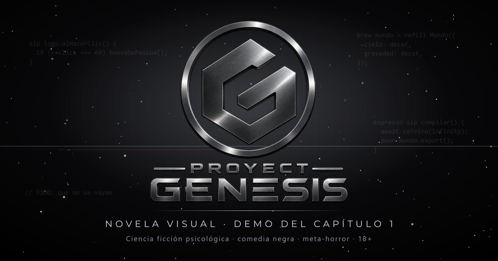

<p align="center">
  
</p>

<h1 align="center">PROYECT GENESIS</h1>

<p align="center">
  Novela visual para adultos · ciencia ficción psicológica · comedia negra · meta-horror<br />
  <strong>Demo del Capítulo 1</strong> · <a href="https://proyect-genesis.vercel.app/">Jugar en el navegador</a>
</p>

---

## De qué trata

Jair es un ingeniero de software de 30 años. Trabaja en soporte técnico, le deben medio mes de sueldo, vive en un departamento que parece una caja de zapatos y lleva ocho años en una relación sin nombre con Nikki, una amiga que le pide que se consiga novia… y que, borracha, le pide que al final se quede con ella.

Una noche, después de emborracharse con Nikki en un bar, Jair recibe un correo con acceso anticipado a **GRAVITY**: un entorno de desarrollo con una inteligencia artificial integrada, **GENESIS**, capaz de construir mundos completos a partir de lo que uno le pida. Le pide un videojuego de fantasía con dos heroínas. Se queda dormido sobre el teclado. Y GENESIS termina el juego sola.

Cuando Jair abre los ojos, está adentro.

PROYECT GENESIS empieza como un isekai con dos heroínas que se disputan al protagonista, y poco a poco desarma esa fantasía pieza por pieza. Es una historia sobre crear personas a la medida de lo que uno desea, y sobre lo que pasa cuando esas personas descubren quién las hizo y para qué.

> **18+.** Contiene manipulación emocional, alcoholismo, sexualidad sugerida (nunca explícita), angustia psicológica, violencia fantástica y lenguaje vulgar. Todos los personajes son ficticios.

## Estado actual

**Demo del Capítulo 1, «Una vida en bucle»: jugable de principio a fin.**

| | |
| --- | --- |
| Capítulo 1 | ✅ Completo, con arte: unas 1.300 escenas, 19 decisiones y 8 bad ends |
| Capítulo 2 | 🚧 En escritura (borrador; todavía no se puede jugar desde el Capítulo 1) |
| Capítulos 3 a 7 | 📝 Planificados |
| Expansiones | 📝 Planificadas: RikkaQuest, Génesis++ y Génesis# |
| Idiomas | Español e inglés (el capítulo 1 está traducido completo) |

La historia completa tendrá siete capítulos, dos finales principales que ocurren en dos líneas temporales distintas, seis finales alternativos y tres expansiones.

## Qué tiene la demo

- **La noche del bar y el isekai:** el mundo real (la oficina, la heladería, el bar, el departamento) y la dimensión espacial del juego, hasta conocer a Rikka en el puente.
- **Decisiones que importan:** algunas solo cambian una conversación; otras terminan la partida antes de tiempo. Ocho bad ends, cada uno con su pantalla.
- **Mapa de decisiones** interactivo (se arrastra y se hace zoom) para ver los caminos recorridos y volver a cualquier decisión.
- **Galería** de imágenes y de personajes (cada sprite con nombre y una ficha de humor negro que se escribe sola), y de finales. Todo se desbloquea al jugar, y lo nuevo se marca con una bolita.
- **Boringram, el celular de Jair:** publicaciones, historias destacadas, mensajes, perfiles y un panel de notificaciones de apps parodia. Se llena a medida que avanza la historia, avisa cuando hay algo nuevo y se abre desde el título o desde la partida. Se pueden dar y quitar «me gusta» y **compartir las fotos de verdad** en Facebook, WhatsApp, X o Instagram, con su miniatura.
- **Pantallas hechas en código:** el IDE GRAVITY, el correo con su bandeja de spam, el celular con Boringram (la parodia de Instagram), los mensajes y las historias de Nikki.
- **Efectos de meta-horror:** glitches, opciones que el sistema intenta imponer y una voz que solo Jair oye.
- **Retroceder y adelantar** a x2, x4, x8 o x16. Retroceder deshace también las decisiones.
- **Opciones de lectura:** velocidad y tamaño del texto, opacidad de la caja, modo automático, ir a la decisión anterior o a la próxima, ocultar la interfaz, volumen y silencio, y reducir efectos.
- **Guardado** en el navegador, con miniatura de cada partida. «Continuar» retoma el último guardado.
- **Celular:** se juega en horizontal y a pantalla completa; Boringram se ve en vertical, como una app.
- Y un easter egg en la pantalla de título.

## Cómo jugar

En el navegador, sin instalar nada: **https://proyect-genesis.vercel.app/**

Avanza con el botón «Siguiente», Espacio o Enter, y vuelve una línea con ← o Retroceso. Las decisiones también se eligen con las teclas 1, 2, 3… La tecla H oculta la caja de texto y la M silencia el audio.

## Para desarrolladores

Hecho con **React + Vite + TypeScript**, con estado en **Zustand** y guardado en `localStorage`.

```bash
npm install
npm run dev            # servidor de desarrollo
npm run build          # comprobación de tipos y build de producción
npm run test:routes    # recorre todas las rutas de la historia y comprueba que no haya escenas rotas
```

Herramientas del proyecto:

| Comando | Qué hace |
| --- | --- |
| `npm run guion:exportar` / `guion:importar` | Sincroniza el guion en JSON con un libreto legible en `docs/guion/` |
| `npm run sprites` | Exporta los sprites desde un PSB por personaje (`docs/sprites/`), con la estatura de cada uno y alineados entre expresiones; solo relee los archivos que cambiaron |
| `npm run fondos` | Convierte los fondos a WebP y los coloca en las escenas que los usan |
| `npm run og` | Genera la imagen que se ve al compartir el enlace |
| `npm run compartir` | Genera la página y la miniatura de cada foto de Boringram para compartir en redes |

La historia vive en JSON, nunca dentro de los componentes:

```
src/
  components/   escenario, caja de diálogo, decisiones, mapa, menús, pantallas en código
  engine/       motor de la historia, estado, guardado, sonido, idiomas, transiciones
  data/
    chapters/   cap01.json, cap02.json…
    i18n/       textos de la interfaz en español e inglés
    en/         versiones en inglés de pantallas, menús y capítulos (en/chapters/)
docs/           canon, tono, finales, especificación técnica y libretos
tools/          scripts de sprites, fondos, guion e imagen para compartir
tests/          prueba automática de rutas
```

La documentación de la obra está en `docs/`: `CANON.md` (la fuente de verdad de la historia), `TONO.md`, `FINALES.md` y `SPEC.md` (el motor).

## Cómo se hizo

PROYECT GENESIS nació en octubre de 2026. Es un proyecto indie hecho por una sola persona: historia, dirección, diseño y programación.

Es, a propósito, una historia sobre una inteligencia artificial que crea personajes, hecha con ayuda de inteligencias artificiales: ChatGPT y Gemini para dar forma a la biblia de la historia, Claude Code para programar el motor y redactar borradores, y Gemini para generar el arte.

Influencias de atmósfera: *Welcome to the NHK*, *Perfect Blue*, *Neon Genesis Evangelion* y *Scott Pilgrim*.

## Apoya el proyecto

Si el juego te gustó, en la pantalla de título, en **«Conoce más del proyecto»**, están los enlaces del autor y la opción de donar.
